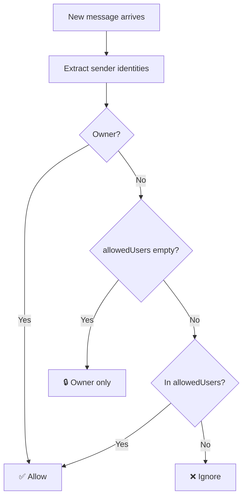
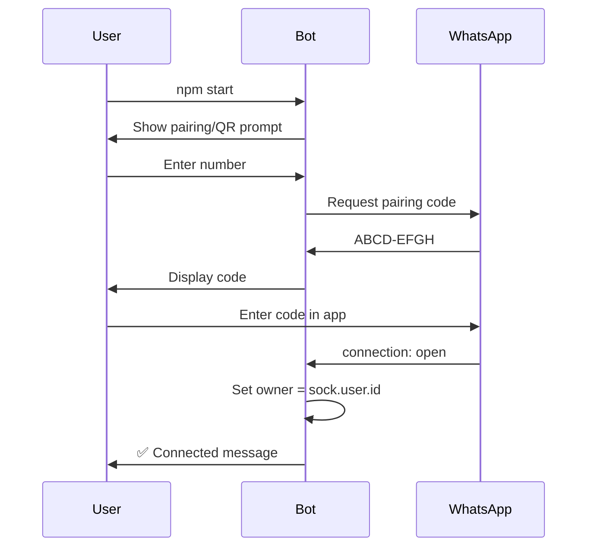

<div align="center">


# 🤖 Baileys Assistant Bot

**A powerful, RAM-aware WhatsApp bot built with [Baileys](https://github.com/WhiskeySockets/Baileys)**

[](https://nodejs.org/)
[](https://github.com/WhiskeySockets/Baileys)
[](https://railway.app/)
[](LICENSE)
[](http://makeapullrequest.com)

_📥 Download files • ⚡ Priority queue • 🧠 Smart RAM protection • 🔐 Auto owner detection_

</div>

---

## 📖 Table of Contents

- [✨ Features](#-features)
- [🚀 Quick Start](#-quick-start)
- [⚙️ Configuration](#️-configuration)
- [📱 Deployment](#-deployment)
- [🎮 Commands](#-commands)
- [🧠 How It Works](#-how-it-works)
- [🛡️ Security](#️-security)
- [📁 Project Structure](#-project-structure)
- [🔧 Troubleshooting](#-troubleshooting)
- [📊 Performance](#-performance)
- [🗺️ Roadmap](#️-roadmap)
- [🤝 Contributing](#-contributing)

---

## ✨ Features

<table>
<tr>
<td width="50%">

### 📥 Smart Downloads

- Download files from direct links
- **Real-time RAM-aware** size validation
- Auto-blocks files exceeding free memory
- Dynamic safe download limits
- File type auto-detection (`file-type`)
- MIME fallback for unknown types
- Windows-safe file handling

</td>
<td width="50%">

### ⚡ Priority Queue

- Queue-based download management
- Move items to front (`.qf 3`)
- Add urgent links directly (`.qf <url>`)
- Live progress tracking (`.du`)
- Speed + ETA display
- Cancel entire queue (`.dq`)

</td>
</tr>
<tr>
<td width="50%">

### 🔐 Flexible Authorization

- **Interactive startup prompt**
- Owner-only mode (empty list)
- Whitelist allowed users
- Automatic **LID → Phone** resolution
- Works with phone numbers **or** LIDs
- Exact-match validation (no false positives)

</td>
<td width="50%">

### ☁️ Cloud-Ready

- Environment variables support
- Railway / Koyeb / Render / Heroku ready
- Session persistence
- Auto-reconnect on disconnect
- Graceful shutdown
- No interactive prompt on cloud

</td>
</tr>
<tr>
<td width="50%">

### 🖥️ System Utilities

- `.sys` — OS, RAM, CPU, uptime
- `.jid` — current chat JID
- `.fw` — forward without tag
- Detailed OS detection (Termux, Docker, cloud)

</td>
<td width="50%">

### 🛠️ Developer Friendly

- Modular architecture
- Global error handlers
- Clean logging with ANSI colors
- Zero-config for local testing
- MIT licensed

</td>
</tr>
</table>

---

## 🚀 Quick Start

### Prerequisites

| Requirement  | Version        |
| ------------ | -------------- |
| **Node.js**  | v18 or higher  |
| **npm**      | Latest         |
| **WhatsApp** | Active account |

### Installation

```bash
# Clone the repository
git clone https://github.com/yourusername/baileys-assistant-bot.git
cd baileys-assistant-bot

# Install dependencies
npm install

# Run the bot
npm start
```

### 🎬 First Run — Interactive Setup

When you run `npm start`, the bot will guide you through setup:

```text
───────────────────────────────────────────────────────
🤖  Bot Startup Setup
───────────────────────────────────────────────────────

  1) 🔑 Pairing Code
  2) 📷 QR Code

  Choose [1/2]: _
```

### 📝 Setup Steps

<table>
<tr>
<td width="60">

**1️⃣**

</td>
<td>

**Choose connection method**

- `1` for Pairing Code (faster, no camera needed)
- `2` for QR Code (scan with phone)

</td>
</tr>
<tr>
<td>

**2️⃣**

</td>
<td>

**(Pairing only) Enter your WhatsApp number**

```
📞 Enter your WhatsApp number (with country code): 94768830907
```

⚠️ Format: **country code + number, no `+` or spaces**

</td>
</tr>
<tr>
<td>

**3️⃣**

</td>
<td>

**Enter allowed users (or skip for owner-only)**

```
👥 Enter allowed user numbers
   (separate multiple numbers with commas or spaces)
   ⏎ Just press Enter to allow ONLY YOU (owner)

📋 Allowed users: 94711111111, 94722222222
```

⏎ **Just press Enter** → owner-only mode 🔒

</td>
</tr>
<tr>
<td>

**4️⃣**

</td>
<td>

**Enter the pairing code / scan QR**

```
🔑 Your WhatsApp Pairing Code: ABCD-EFGH
```

Open WhatsApp → **Settings** → **Linked Devices** → **Link a Device** → Enter code.

</td>
</tr>
</table>

**🎉 Done!** Your bot is now live.

---

## ⚙️ Configuration

Choose **any one** of these three methods (priority order):

### 🥇 Option 1: Environment Variables _(recommended for cloud)_

**Railway / Koyeb / Render Dashboard → Variables tab:**

| Variable           | Value                   | Example                   |
| ------------------ | ----------------------- | ------------------------- |
| `USE_PAIRING_CODE` | `true` or `false`       | `true`                    |
| `PAIRING_NUMBER`   | Your WhatsApp number    | `94768830907`             |
| `ALLOWED_USERS`    | Comma-separated numbers | `94711111111,94722222222` |

### 🥈 Option 2: `config.js` _(recommended for VPS)_

```js
export default {
  prefix: ".",
  botName: "Baileys Assistant Bot",

  // 🔑 Connection method
  usePairingCode: true, // true = Pairing Code | false = QR Code
  pairingNumber: "94768830907", // Your WhatsApp number (digits only)

  // 👥 Who can use the bot
  allowedUsers: [
    "94711111111", // Add allowed users here
    "94722222222",
  ],
  // Empty array [] = owner only 🔒
};
```

### 🥉 Option 3: Interactive Prompt _(local only)_

Do nothing — the bot will ask you on startup. Perfect for local testing.

### 📊 Priority Order

```
Environment Variables  →  config.js  →  Interactive Prompt
     (Railway)             (VPS)           (Local)
```

The bot automatically picks the first **available** source.

---

## 📱 Deployment

<details>
<summary><b>🚂 Railway — Step by Step</b></summary>

### 1️⃣ Prepare your code

Make sure `config.js` has **real numbers** OR use environment variables (recommended).

### 2️⃣ Push to GitHub

```bash
git add .
git commit -m "Ready for Railway"
git push origin main
```

### 3️⃣ Create Railway project

1. Go to [railway.app](https://railway.app)
2. Click **New Project** → **Deploy from GitHub repo**
3. Select your repository
4. Railway auto-detects Node.js

### 4️⃣ Add environment variables

**Variables** tab → **New Variable**:

```
USE_PAIRING_CODE=true
PAIRING_NUMBER=94768830907
ALLOWED_USERS=94711111111,94722222222
```

### 5️⃣ Get the pairing code

1. Go to **Deployments** → **View Logs**
2. Wait for:
   ```
   🔑 Your WhatsApp Pairing Code: ABCD-EFGH
   ```
3. Open WhatsApp → **Linked Devices** → **Link a Device**

> ⚠️ **Important:** Railway has no interactive TTY — **environment variables are required**.

</details>

<details>
<summary><b>🎨 Koyeb / Render / Heroku</b></summary>

Same approach as Railway:

1. Push code to GitHub
2. Create new app on the platform
3. Add environment variables in dashboard
4. Deploy — auto-detects Node.js
5. Check logs for pairing code

**Koyeb:** Add `NODE_ENV=production` too for best performance.

**Render:** Set **Build Command** = `npm install`, **Start Command** = `npm start`.

</details>

<details>
<summary><b>🖥️ VPS / Raspberry Pi (with PM2)</b></summary>

```bash
# Install PM2 globally
npm install -g pm2

# Start the bot
pm2 start index.js --name baileys-bot

# Auto-start on reboot
pm2 save
pm2 startup

# View logs
pm2 logs baileys-bot

# Restart / Stop
pm2 restart baileys-bot
pm2 stop baileys-bot
```

**Recommended specs:**

- 512 MB RAM minimum
- 1 GB disk space
- Any modern Linux distro

</details>

<details>
<summary><b>🐳 Docker (advanced)</b></summary>

Create `Dockerfile`:

```dockerfile
FROM node:18-alpine
WORKDIR /app
COPY package*.json ./
RUN npm install --production
COPY . .
CMD ["node", "index.js"]
```

Build & run:

```bash
docker build -t baileys-bot .
docker run -d \
  --name baileys-bot \
  -e USE_PAIRING_CODE=true \
  -e PAIRING_NUMBER=94768830907 \
  -e ALLOWED_USERS=94711111111 \
  -v $(pwd)/session:/app/session \
  baileys-bot
```

</details>

---

## 🎮 Commands

> 💡 **All commands use the prefix** (default: `.`)  
> Example: `.dl https://example.com/file.pdf`

### 📥 Download Commands

| Command            | Description                                | Example                    |
| ------------------ | ------------------------------------------ | -------------------------- |
| **`.dl <link>`**   | Download file from a direct link           | `.dl https://ex.com/a.pdf` |
| **`.qf <number>`** | Move a queue item to the top               | `.qf 3`                    |
| **`.qf <link>`**   | Add an urgent link next in line            | `.qf https://ex.com/b.zip` |
| **`.du`**          | Check active download progress, speed, ETA | `.du`                      |
| **`.q`**           | View the complete download queue           | `.q`                       |
| **`.dq`**          | Stop active download + clear queue         | `.dq`                      |

### ⚙️ Utility Commands

| Command          | Description                         | Example           |
| ---------------- | ----------------------------------- | ----------------- |
| **`.menu`**      | Display the command menu            | `.menu`           |
| **`.fw <jids>`** | Forward replied message without tag | `.fw 94711111111` |
| **`.jid`**       | View the current chat JID           | `.jid`            |
| **`.sys`**       | Show OS, RAM, CPU, uptime info      | `.sys`            |

### 💡 Real Examples

```bash
# Download a small file
.dl https://example.com/file.pdf

# Add an urgent link (jumps queue)
.qf https://example.com/urgent.zip

# Move queue item #4 to position #1
.qf 4

# Check download progress
.du

# View the queue
.q

# Cancel everything
.dq

# Forward a message to 2 recipients
.fw 94711111111 94722222222

# See bot hosting info
.sys
```

### 📋 Quick Reference Card

```
📥 DOWNLOAD
  .dl <link>          Download a file
  .qf <num|link>      Priority queue
  .du                 Progress status
  .q                  View queue
  .dq                 Cancel queue

⚙️ UTILITY
  .menu               Command menu
  .fw <jids>          Forward without tag
  .jid                Current chat JID
  .sys                System info
```

---

## 🧠 How It Works

### 🔐 Authorization Flow



### 🎯 LID → Phone Number Resolution

Modern WhatsApp uses **LIDs** (Linked IDs) instead of raw phone numbers:

```
Old: 94768830907              (phone number visible)
New: 102404955582676@lid      (opaque ID)
```

The bot resolves LIDs automatically via **4 methods** (fallback chain):

| #   | Method                                          | Speed      | When                 |
| --- | ----------------------------------------------- | ---------- | -------------------- |
| 1   | **Cache**                                       | ⚡ Instant | After first lookup   |
| 2   | **`signalRepository.lidMapping.getPNForLID()`** | ~500ms     | Official Baileys API |
| 3   | **Contacts sync** (background)                  | Auto       | Bot running > 2 min  |
| 4   | **Manual `config.lidMapping`**                  | ⚡ Instant | Emergency fallback   |

### 💾 RAM-Aware Downloads

Every download checks **free RAM** in real-time:

```
Safe Download Limit = Free RAM − 150 MB (safety buffer)
```

| Free RAM | Max Safe Download |
| -------- | ----------------- |
| 2 GB     | ~1.85 GB          |
| 1 GB     | ~850 MB           |
| 500 MB   | ~350 MB           |
| 250 MB   | ~100 MB           |
| 100 MB   | ❌ Blocked        |

If a file exceeds the limit → **auto-blocked** with a clear message.

### 🔄 Connection Lifecycle



---

## 🛡️ Security

| Feature                      | Description                                               |
| ---------------------------- | --------------------------------------------------------- |
| 🔒 **Owner-only mode**       | Leave `allowedUsers` empty for maximum security           |
| ✅ **Exact match**           | No false-positive matches (unlike substring `includes()`) |
| 🔑 **Session isolation**     | Session files stored locally, never shared                |
| 🚫 **Private repo**          | Keep your numbers out of public GitHub                    |
| 🛡️ **No shell execution**    | No arbitrary command execution risk                       |
| 💾 **Temp cleanup**          | Downloads deleted after sending                           |
| 🧹 **File handle safety**    | Force-close writer streams on abort                       |
| ⚠️ **Global error handlers** | Prevents crashes from uncaught exceptions                 |

### 🔐 Recommended Settings

**For maximum security (owner-only):**

```js
allowedUsers: []; // Only you can use the bot
```

**For team / family use:**

```js
allowedUsers: ["94711111111", "94722222222"];
```

---

## 📁 Project Structure

```text
baileys-assistant-bot/
│
├── 📄 index.js                  # Main entry point + WhatsApp socket
├── 📄 config.js                 # Static configuration
├── 📄 package.json              # Dependencies & scripts
├── 📄 README.md                 # This file
├── 📄 .gitignore                # Excludes session/, temp/, .env
│
├── 📂 lib/
│   ├── startup.js               # Interactive setup prompt
│   ├── utils.js                 # RAM, formatting, OS helpers
│   └── downloader.js            # Download queue processor
│
├── 📂 handlers/
│   └── commandHandler.js        # Command dispatcher
│
├── 📂 session/                  # 🔒 (auto) WhatsApp auth state
├── 📂 temp/                     # 🗑️ (auto) Temporary downloads
└── 📂 data/                     # 💾 (auto) Optional persistence
```

### 📄 File Responsibilities

| File                         | Purpose                                   |
| ---------------------------- | ----------------------------------------- |
| `index.js`                   | Socket connection, message routing, auth  |
| `config.js`                  | Static values (prefix, botName, defaults) |
| `lib/startup.js`             | Interactive prompt OR env var reader      |
| `lib/downloader.js`          | Queue processing, download, upload        |
| `lib/utils.js`               | RAM checks, byte formatting, OS detection |
| `handlers/commandHandler.js` | All command implementations               |

---

## 🔧 Troubleshooting

<details>
<summary><b>❌ Bot keeps reconnecting (status 401)</b></summary>

**Cause:** Invalid pairing number or session logged out.

**Fix:**

```bash
rm -rf session
npm start
```

Then re-pair with a valid number.

</details>

<details>
<summary><b>❌ Pairing code never appears</b></summary>

**Cause:** Empty `pairingNumber` with `usePairingCode: true` (silent hang).

**Fix:**

Either set a real number:

```js
pairingNumber: "94768830907";
```

Or switch to QR mode:

```js
usePairingCode: false;
```

</details>

<details>
<summary><b>❌ Railway deploy hangs — no interactive prompt</b></summary>

**Cause:** Railway has no TTY — interactive prompt can't run.

**Fix:** Use environment variables in Railway Dashboard:

```
USE_PAIRING_CODE=true
PAIRING_NUMBER=94768830907
ALLOWED_USERS=94711111111,94722222222
```

The bot auto-detects these and skips the prompt.

</details>

<details>
<summary><b>❌ Allowed users can't trigger commands</b></summary>

**Cause:** LID not resolved yet (contacts not synced).

**Fix:**

1. Wait **2–3 minutes** after bot starts
2. Ask the user to send **two messages** (first warms cache)
3. Use `.jid` to check their actual JID

**Owner always works** — only allowed users are affected.

</details>

<details>
<summary><b>❌ Command not working — bot ignores it</b></summary>

**Cause:** You may be using an **old command name**.

**Fix:** This bot supports only the **short commands**. Check the [Commands](#-commands) section:

| ❌ Old (removed) | ✅ New  |
| ---------------- | ------- |
| `.dlurlm`        | `.dl`   |
| `.qm`            | `.q`    |
| `.dqm`           | `.dq`   |
| `.fwm`           | `.fw`   |
| `.platform`      | `.sys`  |
| `.help`          | `.menu` |

</details>

<details>
<summary><b>❌ EMFILE: too many open files</b></summary>

**Cause:** File handle leak from aborted downloads (fixed in v1.0+).

**Fix:** Ensure `downloader.js` has `writer.destroy()` in:

- RAM-low abort path
- Network error path
- `finally` safety net

</details>

<details>
<summary><b>❌ File deleted but disk still full (Linux)</b></summary>

**Cause:** Open file handle keeps disk space reserved.

**Fix:** Restart the bot to release handles, then update `downloader.js` with proper `writer.destroy()` calls.

</details>

<details>
<summary><b>❌ WhatsApp number in config shows as `94XXX` in logs</b></summary>

**Cause:** Placeholder number left in config.

**Fix:** Replace with real number — placeholders cause silent pairing failure.

</details>

---

## 📊 Performance

| Metric                          | Value                   |
| ------------------------------- | ----------------------- |
| **Idle RAM**                    | ~80 MB                  |
| **Peak RAM**                    | ~200 MB + file size     |
| **Startup time**                | ~3 seconds              |
| **Message latency (cached)**    | <100 ms                 |
| **Message latency (first LID)** | ~500 ms                 |
| **Max queue size**              | Unlimited (RAM-bounded) |
| **Concurrent downloads**        | 1 (sequential, safer)   |

### 🎯 Optimized For

- ✅ Low-RAM servers (512 MB+)
- ✅ Free-tier cloud (Railway, Render)
- ✅ Raspberry Pi / ARM devices
- ✅ 24/7 uptime with auto-reconnect

---

## 🗺️ Roadmap

### ✅ Completed

- [x] RAM-aware download blocking
- [x] Priority queue system
- [x] LID → Phone number resolution
- [x] Interactive startup prompt
- [x] Environment variable support
- [x] File handle leak fix
- [x] Owner-only mode
- [x] Cloud deployment ready
- [x] Short command names (`.dl`, `.q`, `.dq`, `.fw`, `.sys`)

### 🚧 In Progress

- [ ] Real-time rolling speed calculation
- [ ] Media re-upload for `.fw`
- [ ] Download resume support

### 💡 Planned

- [ ] YouTube / audio downloader
- [ ] Sticker creation
- [ ] Group admin tools
- [ ] Web dashboard

---

## 🤝 Contributing

Contributions are what make the open-source community amazing!

### How to Contribute

1. **Fork** the repository
2. **Create** your feature branch
   ```bash
   git checkout -b feature/amazing-feature
   ```
3. **Commit** your changes
   ```bash
   git commit -m "Add amazing feature"
   ```
4. **Push** to the branch
   ```bash
   git push origin feature/amazing-feature
   ```
5. **Open** a Pull Request

### 🐛 Reporting Bugs

Open an [issue](https://github.com/yourusername/baileys-assistant-bot/issues) with:

- Clear description
- Steps to reproduce
- Expected vs actual behavior
- Node version + platform

### 💡 Suggesting Features

Open an issue with the **enhancement** label.

---

## 📜 License

This project is licensed under the **MIT License**.

```text
MIT License

Copyright (c) 2025 Your Name

Permission is hereby granted, free of charge, to any person obtaining a copy
of this software and associated documentation files...
```

See [LICENSE](LICENSE) for full text.

---

## 🙏 Credits

<table>
<tr>
<td align="center" width="33%">

### 🔌 Baileys

[](https://github.com/WhiskeySockets/Baileys)

WhatsApp Web API library

</td>
<td align="center" width="33%">

### 📱 qrcode-terminal

[](https://www.npmjs.com/package/qrcode-terminal)

Terminal QR code generator

</td>
<td align="center" width="33%">

### 📝 pino

[](https://www.npmjs.com/package/pino)

Ultra-fast logging

</td>
</tr>
</table>

---

## 📞 Contact & Support

<div align="center">

**Have questions? Need help?**

[](https://github.com/yourusername/baileys-assistant-bot/issues)
[](https://github.com/yourusername/baileys-assistant-bot/discussions)

</div>

---

<div align="center">

### ⭐ If this project helped you, consider giving it a star!

**Made with ❤️ and ☕ by [Your Name](https://github.com/yourusername)**


</div>
